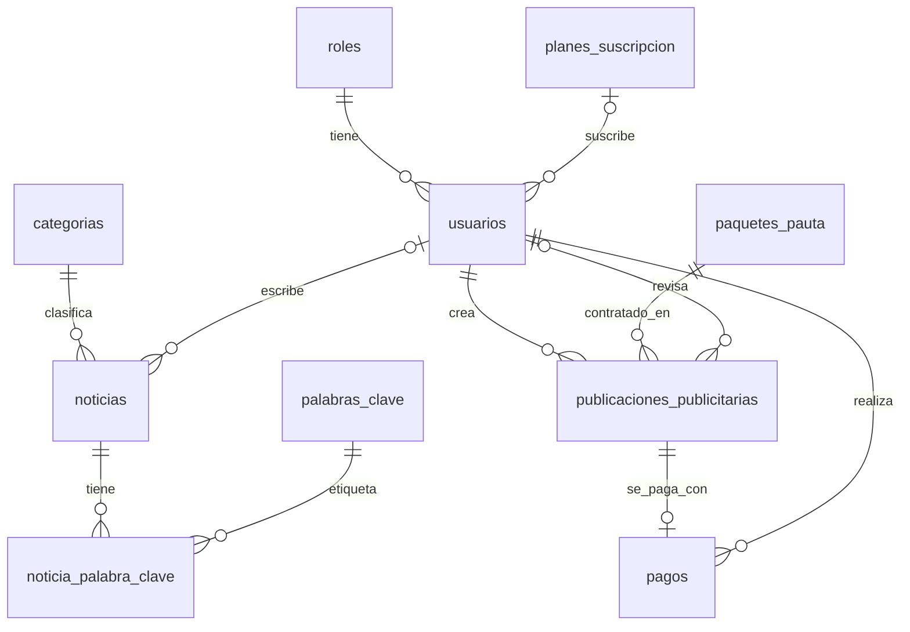

# GlobalNews

Sistema web de publicación de noticias desarrollado como Proyecto Final del curso **Programación en Ambiente Web II** (III Cuatrimestre 2026, UTN Sede San Carlos), profesora Milena Vargas Blanco.

Los **clientes** consultan, buscan y filtran noticias; los **clientes publicitarios** compran paquetes de pauta y publican anuncios que quedan pendientes de revisión; los **administradores** gestionan noticias y categorías y aprueban las publicaciones.

## Integrantes

| Integrante | Responsabilidad |
|---|---|
| Valery Salas Vargas | Arquitectura, base de datos, autenticación y roles, manejo de errores, README |
| _(Persona B)_ | Módulo de noticias y categorías |
| _(Persona C)_ | Publicidad, widgets de API externa e identidad visual |

## Tecnologías

| Capa | Tecnologías |
|---|---|
| Backend | Node.js, Express 5, TypeScript (modo `strict`), arquitectura por capas (rutas → controladores → servicios → modelos) |
| Base de datos | PostgreSQL con la librería `pg` |
| Seguridad | `bcrypt` para cifrar contraseñas, JWT (`jsonwebtoken`) para la sesión, control de acceso por roles |
| Validación | Zod (mensajes en español) |
| Frontend | React 19, Vite, TypeScript, React Router, Tailwind CSS v4 |

## Estructura del proyecto

```
├── server/                    API REST (Express + TypeScript)
│   ├── database/schema.sql    Tablas, relaciones e índices
│   ├── scripts/               Ejecutar el esquema y cargar datos de prueba
│   └── src/
│       ├── config/            Variables de entorno, conexión a PostgreSQL, Zod
│       ├── routes/            Definición de rutas por módulo
│       ├── controllers/       Leen la petición y envían la respuesta
│       ├── services/          Lógica de negocio
│       ├── models/            Consultas SQL
│       ├── middlewares/       Autenticación, roles, validación y errores
│       ├── validators/        Esquemas de Zod
│       ├── types/             Interfaces y tipos de TypeScript
│       └── utils/             Clases de error
└── client/                    Interfaz (React + Vite)
    └── src/
        ├── pages/             Páginas (una por ruta)
        ├── components/        Componentes reutilizables
        ├── layouts/           Estructura común (Navbar + Footer)
        ├── context/, hooks/   Sesión del usuario (AuthProvider, useAuth)
        ├── services/          Llamadas a la API con fetch
        └── types/             Tipos de TypeScript
```

## Requisitos

- [Node.js](https://nodejs.org/) 22 o superior (versión LTS)
- [PostgreSQL](https://www.postgresql.org/download/) 14 o superior (con pgAdmin)
- Git

## Instalación

### 1. Clonar el repositorio

```bash
git clone https://github.com/valesv24-ui/Proyecto-final-GlobalNews---Ambiente-web.git
cd Proyecto-final-GlobalNews---Ambiente-web
```

### 2. Crear la base de datos

En pgAdmin: clic derecho en **Databases → Create → Database...**, nombre `globalnews`, y **Save**.

### 3. Configurar y preparar el backend

```bash
cd server
npm install
copy .env.example .env        # en Linux/Mac: cp .env.example .env
```

Edite `server/.env` con sus datos (ver [Variables de entorno](#variables-de-entorno)) y luego cree las tablas con los datos de prueba:

```bash
npm run db:reset
```

### 4. Configurar el frontend

```bash
cd ../client
npm install
copy .env.example .env        # en Linux/Mac: cp .env.example .env
```

### 5. Ejecutar

Se necesitan **dos terminales** abiertas al mismo tiempo:

```bash
# Terminal 1 - API
cd server
npm run dev        # http://localhost:3001

# Terminal 2 - Interfaz
cd client
npm run dev        # http://localhost:5173
```

Abra **http://localhost:5173**. Si la página de inicio muestra "API de GlobalNews funcionando" en verde, todo está conectado.

## Variables de entorno

### `server/.env`

| Variable | Descripción | Ejemplo |
|---|---|---|
| `PORT` | Puerto de la API | `3001` |
| `NODE_ENV` | `development` muestra detalles de los errores; `production` los oculta | `development` |
| `CLIENT_URL` | URL del frontend permitida por CORS | `http://localhost:5173` |
| `DB_HOST` | Servidor de PostgreSQL | `localhost` |
| `DB_PORT` | Puerto de PostgreSQL (ver en pgAdmin → Properties → Connection) | `5432` |
| `DB_USER` | Usuario de PostgreSQL | `postgres` |
| `DB_PASSWORD` | Contraseña de ese usuario | _(la suya)_ |
| `DB_NAME` | Nombre de la base de datos | `globalnews` |
| `JWT_SECRET` | Clave para firmar los tokens. **Obligatoria**: sin ella el servidor no arranca | _(texto aleatorio largo)_ |
| `JWT_EXPIRES_IN` | Duración de la sesión | `8h` |

Para generar un `JWT_SECRET`:

```bash
node -e "console.log(require('crypto').randomBytes(48).toString('hex'))"
```

### `client/.env`

| Variable | Descripción | Ejemplo |
|---|---|---|
| `VITE_API_URL` | URL base de la API | `http://localhost:3001/api` |

> Los archivos `.env` no se suben al repositorio (están en `.gitignore`). Solo se suben los `.env.example`.

## Comandos

### Backend (`server/`)

| Comando | Qué hace |
|---|---|
| `npm run dev` | Inicia la API en modo desarrollo (se reinicia al guardar cambios) |
| `npm run build` | Compila TypeScript a JavaScript en `dist/` |
| `npm start` | Ejecuta la versión compilada |
| `npm run db:schema` | Borra y vuelve a crear todas las tablas (**elimina los datos**) |
| `npm run db:seed` | Carga los datos de prueba |
| `npm run db:reset` | `db:schema` + `db:seed` |

### Frontend (`client/`)

| Comando | Qué hace |
|---|---|
| `npm run dev` | Inicia la interfaz en modo desarrollo |
| `npm run build` | Revisa los tipos y genera la versión de producción en `dist/` |
| `npm run lint` | Revisa el código con oxlint |

## Usuarios de prueba

Se crean con `npm run db:seed`. Contraseña de todos: **`GlobalNews2026!`**

| Correo | Rol |
|---|---|
| `admin@globalnews.com` | Administrador |
| `cliente@globalnews.com` | Cliente (plan Premium) |
| `publicidad@globalnews.com` | Cliente publicitario (plan Básico) |

## Base de datos



Reglas de integridad principales:

- No se puede eliminar una **categoría** que todavía tiene noticias (`ON DELETE RESTRICT`).
- Al eliminar una **noticia**, se eliminan sus relaciones con palabras clave (`ON DELETE CASCADE`).
- Si se elimina el administrador autor de una noticia, la noticia se conserva (`ON DELETE SET NULL`).
- Las publicaciones siguen el flujo `pendiente_pago → pendiente_revision → aprobada / rechazada`, controlado con `CHECK`.
- Latitud y longitud deben estar dentro de su rango y registrarse juntas.

El script completo, con comentarios, está en [`server/database/schema.sql`](server/database/schema.sql).

## API

URL base: `http://localhost:3001/api`

Las rutas protegidas requieren el encabezado `Authorization: Bearer <token>`. El token se obtiene en `/auth/login` o `/auth/registro`.

### Autenticación y planes

| Método | Ruta | Acceso | Descripción |
|---|---|---|---|
| GET | `/salud` | Público | Verifica que la API esté funcionando |
| GET | `/planes` | Público | Lista los planes de suscripción |
| POST | `/auth/registro` | Público | Crea una cuenta (`cliente` o `publicitario`) y devuelve el token |
| POST | `/auth/login` | Público | Inicia sesión y devuelve el token |
| GET | `/auth/perfil` | Con sesión | Datos del usuario que inició sesión |

Ejemplo de cuerpo para `/auth/registro`:

```json
{
  "nombre": "Valery Salas",
  "correo": "valery@correo.com",
  "contrasena": "Clave1234",
  "confirmarContrasena": "Clave1234",
  "planId": 2,
  "rol": "cliente"
}
```

### Noticias y categorías

_(Pendiente: Persona B)_

### Publicidad y widgets

_(Pendiente: Persona C)_

### Formato de errores

Todos los errores responden con el mismo formato:

```json
{ "ok": false, "error": { "codigo": 400, "mensaje": "Los datos enviados no son válidos",
  "detalles": [ { "campo": "correo", "mensaje": "Introduce un correo electrónico válido" } ] } }
```

| Código | Cuándo ocurre |
|---|---|
| `400` | Datos inválidos (validación de Zod, JSON mal formado, valores fuera de rango) |
| `401` | Sin token, token alterado o vencido, o credenciales incorrectas |
| `403` | Con sesión, pero el rol no tiene permiso |
| `404` | La ruta o el recurso no existe |
| `409` | Conflicto con datos existentes (correo repetido, registro relacionado) |
| `500` | Error inesperado del servidor (se registra en consola sin detener la API) |

## Solución de problemas

| Mensaje | Solución |
|---|---|
| `Falta la variable de entorno JWT_SECRET` | Agregue `JWT_SECRET` a `server/.env` |
| `ECONNREFUSED ... 5432` | PostgreSQL está apagado o usa otro puerto: revise `DB_PORT` |
| `password authentication failed` | `DB_PASSWORD` no coincide con la contraseña de PostgreSQL |
| `database "globalnews" does not exist` | Cree la base de datos en pgAdmin |
| La página dice "No se pudo conectar con el servidor" | La API (terminal 1) no está corriendo |
| `Cannot GET /` en `localhost:3001` | Es normal: la API solo responde en `/api/...` |
